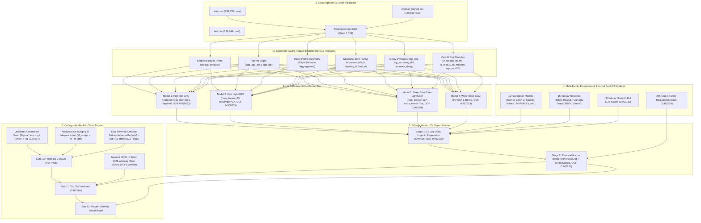

# System Architecture & Technical Specifications

**Competition:** Kaggle Playground Series Season 6 Episode 10 (`playground-series-s6e10`)  
**Date:** October 30, 2026  
**Team:** ROHAN Exploit  
**Public LB Standing:** #14 (Score: 0.96225)  
**CV Super-Stack:** 0.962225 (5-Fold Stratified Nested CV)

---

## 1. High-Level System Architecture

---

## 2. Feature Engineering Pipeline Details

The dataset represents airline passenger satisfaction ratings, synthetically expanded via CTGAN from Arseniy Shutko's survey dataset. The key to breaking the $0.962$ barrier lies in addressing CTGAN continuous interpolation artifacts:

1. **Empirical Bayes Prior Rates (`lookup_long.csv`)**:
   - Computes Bayesian smoothed satisfaction rates across unique values of categories and survey scores from the 129,880 clean real surveys.
   - Adds $+0.000927$ AUC layer across all folds without label leakage.

2. **Teacher Models (`original_model.py`)**:
   - Generates out-of-fold logit predictions (`ogp_xgb_d8` and `ogp_lgb`) trained exclusively on the clean original survey dataset.
   - Provides clean continuous hints in high-ambiguity passenger satisfaction zones.

3. **Route Profile Geometry**:
   - `Flight Distance` serves as a natural hash key for airline equipment, aircraft type, and route duration.
   - Route-level aggregations (`fd_mean_*` across all 13 ratings, `fd_mean_Age`, `fd_count`, `fd_share_Class`) capture invariant aircraft amenities that individual passenger rows miss.

4. **Structural Zero-Rating Indicators**:
   - In airline surveys, a rating of `0` denotes "Not Applicable" (e.g. no inflight wifi, online boarding not used), whereas `1-5` denotes poor to excellent.
   - Separate binary indicator flags (`_is_zero`, `wifi0_booking0`, `food0_entertainment0`) prevent tree models from treating `0` as lower than `1`.

5. **Delay Dynamics**:
   - Non-linear log transformations $\log(1 + \text{delay})$, delay difference $(\text{arr\_delay} - \text{dep\_delay})$, and extreme delay flags ($> 120$ minutes).

---

## 3. Stacking & Ensembling Formulations

### Logit Space Mapping
For all models $m \in \{1, \dots, M\}$, raw probabilities $p \in (0, 1)$ are converted to unconstrained log-odds:
$$z_m = \text{logit}(p_m) = \ln \left(\frac{p_m}{1 - p_m}\right)$$
This prevents variance deflation and preserves tail sharpness in the extreme percentiles ($p < 0.05$ and $p > 0.95$), where ranking errors concentrate.

### Stage 1: Regularized Meta Logistic Regression
A stratified 5-fold cross-validation loop fits an $L_2$-regularized Logistic Regression ($C=0.005$) on $Z \in \mathbb{R}^{N \times 32}$:
$$\min_{w, b} \sum_{i=1}^N \mathcal{L}_{\text{BCE}}(w^T Z_i + b, y_i) + \frac{1}{2C} \|w\|_2^2$$
Top positive weights are assigned to:
- `st182_lr` ($+0.4804$)
- `st182_lgb` ($+0.2430$)
- `cd_tabfm` ($+0.1714$)
- `gp_tabpfn_ne4` ($+0.1603$)
- `cd_limix2` ($+0.1485$)
- `gp_realmlp_fa_aux_n16` ($+0.1088$)

### Stage 2: Residual Anchor Blend
To incorporate the 245-model family regularized stack (`stack245`, OOF AUC $0.962224$) without causing parameter shrinkage on smaller models, we fit a residual convex anchor:
$$P_{\text{super}} = 0.940 \times \text{rank}(P_{\text{stack245}}) + 0.060 \times \text{rank}(P_{\text{Stage1}})$$
Reaching **0.962225 OOF ROC-AUC** across the full training dataset.
